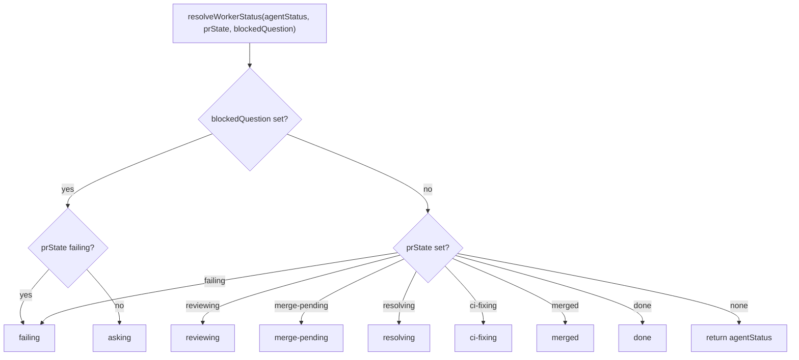
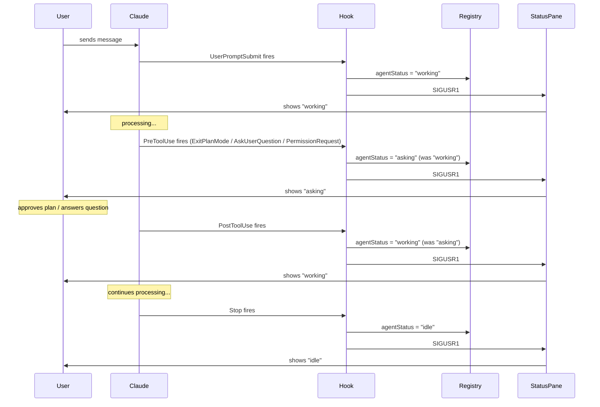

# Worker Status System

Spec for the worker status tracking and display system. This document is
the source of truth for how status works. **If the code disagrees with
this document, the code is wrong.** Past regressions came from racing
pgrep, marker files, and fallback polls; the model below is purely
event-driven and the implementation must stay that way. The sole
sanctioned recurring tick is the liveness watchdog (see "Scheduled
wake-ups" and invariant 6) — it recovers lost event *delivery* (re-poking
a project and respawning a dead poller window) but never detects status
or drives transitions. One named exception reads a pane to detect a
transition, because the harness emits no event for it: an approved
permission dialog (see "Answered permission dialogs" below).

## Display states

These are the only states the user sees in the status pane.

| State         | Icon | Meaning                                          |
|---------------|------|--------------------------------------------------|
| loading       | `H`  | Worker pane started, bootstrap running, Claude not yet launched. |
| ready         | `*`  | Fresh worker. Claude loaded, waiting for first input. |
| working       | `@`  | Claude is generating a response to a submitted prompt, or the display is deriving `working bg` from live delegated work. See "What 'working' means" below. |
| asking        | `?`  | The worker needs operator input: either the agent is blocked mid-turn, or a completed turn recorded `blockedQuestion`. |
| idle          | `#`  | Turn has ended — Claude finished its response and is waiting at the prompt for the next user message. Not in the review cycle. |
| paused        | `‖`  | Operator interrupted the worker mid-turn and is holding it (the `hold` action / `⌥e`). Distinct from `idle`: the operator deliberately halted active work and intends to redirect. Cleared by the next prompt. See "Operator hold" below. |
| reviewing     | `%`  | Automated reviewer is checking the worker's code. |
| merge-pending | `&`  | Review passed. Queued for merge.                 |
| resolving     | `~`  | Automated resolver is fixing a merge-queue rebase conflict. |
| ci-fixing     | `^`  | Self-healing ci-fix agent is investigating a red GitHub Actions check on the merge candidate. |
| merged        | `+`  | Code just landed on the base branch — transient post-merge beat. Neutral color; not actionable. |
| done          | `=`  | Worker self-declared finished via the `.garden-done` sentinel. Bold green; the operator's "cleanup me" signal. |
| failing       | `x`  | Review failed. Waiting for worker to fix.        |
| exited        | `o`  | Worker process is gone.                          |

(Icons shown here are placeholders. Actual Unicode symbols are defined in
`src/commands/status.ts`.)

### What "working" means

The stored `working` state means exactly one thing: **Claude has received
a submitted prompt and has not yet finished its response.** The sole
display-only exception is `working bg`, derived from an honestly `idle`
stored state as described below.

It starts the instant the `UserPromptSubmit` hook fires. Claude Code's
authoritative end signal is `Stop`, or `StopFailure` for a turn that dies
on an API error (a usage limit, an expired login, a dropped connection),
which garden routes to the same turn-end handler; for Codex, the rollout's
final `task_complete` is the backstop when `Stop` is missed, and the
`turn_aborted` an interrupted turn writes in its place (an Escape in the
pane, which fires no `Stop` at all) ends the turn the same way. Nothing
heuristic flips it. Likewise `PostToolUse` fires only for a tool that
succeeded, so its failure twin `PostToolUseFailure` shares its handler:
a failed tool call is the same evidence of activity.

Things that *are* working:
- Generating tokens
- Running tools (Read, Bash, Edit, etc.)
- Calling subagents
- Thinking between tool calls

Things that are *not* working:
- The user typing a message at the prompt (no prompt has been submitted yet)
- The user reading Claude's last response
- Claude sitting at the prompt with nothing to do
- The session being open in a pane the user isn't looking at
- Claude waiting for the user to approve a plan or answer a question (that is `asking`, not `working`)

If a worker shows `working` while Claude is waiting for user input, that
is a bug — the PreToolUse hook for the blocking tool (`ExitPlanMode`,
`AskUserQuestion`) didn't fire or didn't reach the registry. The correct
state in that situation is `asking`.

### Delegated background work (`working bg`)

A worker can end its turn while background work it launched — Task
subagents, background Workflow runs, a `run_in_background` command — is
still executing. Claude Code
fires `Stop` when the main thread finishes its response, so
`agentStatus` is honestly `idle`; but the harness re-invokes the worker
when the background work completes, and to the operator the worker is
still doing its job. A row that reads `idle` there looks finished when
it is not.

The subagents themselves are the evidence: Claude Code fires the parent
session's `PostToolUse` for subagent tool calls, identified by
`agent_id` (see the PostToolUse writer below). Those events move
`agentStatus` only to end an `asking` episode the same subagent's
dialog raised (see the `PermissionRequest` writer below), and each one
stamps `subagentActivityAt` on the worker entry (riding the 10s hook
heartbeat throttle). The renderer —
not the state machine — derives the display (`isDelegating`,
`registry.ts`): an `idle` worker whose newest subagent stamp postdates
its park (`lastStateChangeAt`, the Stop that wrote `idle`) and is
fresher than `SUBAGENT_ACTIVE_WINDOW_MS` (30 min) renders as `working`
— spinner and all — with a dim `bg` tag folded into the state cell.

This is a display derivation, not a transition:

- `agentStatus` stays `idle` in the registry. No state-machine edge
  moves, the review entry path is untouched, and the merge gate
  (`isWorkerClaudeWorking`) still sees `idle` — background subagents
  neither queue reviews nor defer merges. An edit a subagent makes to a
  file in the worktree is the exception: from a review's launch until its
  merge, the mutation marker under `PostToolUse` below sends the worker
  back through review.
- `asking` is excluded: the derivation applies to `idle` only, so a
  worker blocked on the operator keeps its yellow flag no matter how
  busy its subagents are — the original reason a subagent's
  `PostToolUse` never moves `agentStatus` except to end an `asking`
  episode that subagent's own dialog raised.
- The display self-clears through ordinary events: when the background
  work finishes, the harness re-invokes the main thread, and its own
  events bump `lastStateChangeAt` past the stamp. The freshness window
  only bounds the pathological case — subagents that died without a
  trace (harness crash), leaving no later event to supersede the stamp
  — and its decay repaints via the watchdog's 60s status re-bake, which
  re-renders existing state and discovers no transition.

The stamp's flip write — the first subagent event after `Stop` —
bypasses the heartbeat throttle and triggers a repaint, because it is
the only carrier of the idle→`working bg` change; steady-state stamps
stay throttled as ordinary heartbeats.

A background **command** fires no hook while it runs, so its evidence is
the transcript, read at the one moment it matters: the `Stop` that
parks the worker. Claude Code records each launch (a tool result whose
`toolUseResult` carries `backgroundTaskId`, `isAsync` + `agentId` for
an async Agent, or `taskId` + `timeoutMs` for a non-persistent Monitor)
and each end (a `<task-notification>` with a `<status>`, a Monitor's
expiry notice, or a `TaskStop` call, which emits no notification). The
Stop hook scans
what the transcript appended since its previous scan and stores the
launched-but-unended ids with the scan's byte offset in
`backgroundTasks` (`background-tasks.ts`); `isDelegating` renders an
`idle` worker with a non-empty set as `working bg`. The same three
properties hold — `agentStatus` stays `idle`, `asking` is excluded, and
the display self-clears: a finished task starts a new turn whose `Stop`
rescans without it. There is no freshness window, because a benchmark
watcher legitimately runs for hours; instead the set is reset to empty
by every `SessionStart` except `compact`, since a new process holds no
background tasks (compaction happens inside a live one). A task running
when the process dies is therefore never revived by a later scan.

Any harness-tracked background command counts, including a dev server
left running across turns: it is running, and its exit would wake the
worker. Processes the agent detaches itself (`nohup … &`) are invisible
to the harness and are not tracked. A bounded Monitor is tracked: its
per-event notifications carry no `<status>`, but the notification that
ends its stream does, and that is what marks it finished. A Monitor whose
timeout lapses first sends no `<status>` either: its last notification's
event reads `[Monitor expired after …]`, and that marks it finished too.
A `persistent` Monitor watches for the life of the session and never
ends, so it is not a wait and is not tracked. claude-code only — Codex records no such
lifecycle.

### Operator hold (paused)

Beyond the delegated-background display above, there is one case where a
worker that is *not* working can still legitimately display `working`,
and it is the reason the `paused` state exists: a **user interrupt**. When the operator presses Escape in the worker's Claude pane, the
turn is aborted but **no hook fires** — Claude Code's `Stop` hook does not run
on a user interrupt, and there is no interrupt/abort hook at all. So the
registry never hears about the interrupt and the worker stays painted as
`working` until the operator submits a new prompt. A Codex worker is the
exception: its rollout records the interrupt as `turn_aborted`, which ends
the turn (see the Codex rollout turn end under "Writers"); a `hold` still
writes `paused`, which the rollout listener leaves alone.

The `paused` state closes that gap, but only as an *operator-initiated* action,
because a raw Escape is unobservable. The `hold` action (`garden hold <worker>`
or the dashboard `⌥e` hotkey on the focused worker) does two things atomically:
it sends Escape to the worker's pane (the interrupt) and writes
`agentStatus = "paused"`. The operator action — a keystroke — is the event; it
is exactly as event-driven as a hook firing (invariant 6). `paused` means "the
operator deliberately halted this worker mid-turn and is holding it for a
redirect"; it is distinct from `idle` (turn ended naturally) in provenance and
intent, even though both sit at the prompt awaiting input.

`paused` clears the moment the operator submits their redirect
(`UserPromptSubmit → working`), the same path that clears `merged`/`done`. The
dashboard `⌥e` hotkey also toggles: pressing it on an already-held worker
releases it back to `idle` (the "never mind" path) without sending a prompt.

### Blocked on the operator (a display derivation, not a stored state)

A worker that has pushed what it can and needs an operator decision before it
can go further runs `garden blocked "<question>"`, which stamps
`WorkerEntry.blockedQuestion` and writes the `.garden-awaiting-input` sentinel.
`resolveWorkerStatus` then reports that worker as **`asking`** — the state garden
already uses for "the agent needs you" — so it inherits that display treatment
whole: the bold yellow row, the `⚑` icon, the top blocked-on-you band with the
question trailing the row's topic, the plot strip's yellow flag, and `whoami`.
One derivation rather than parallel special cases. It outranks the lifecycle
states, which describe where the worker's *code* is rather than what it needs
from a person; `failing` is the exception, because red means something is broken
and that outranks a question. No alert is raised: the alerts pane is for faults,
and the plot strip is what makes a waiting question visible to an operator who is
away from the row.

This is a **display derivation only**, exactly like `isDelegating` → `working`
above: `agentStatus` and `prState` are untouched in the registry, so review/merge
gating and the poller keep seeing the real state (a blocked worker parked at
`merged` still merges, still gates, still sorts by its real lifecycle where that
matters). While that derivation is displayed as `asking`, the state cell's
elapsed counts from `blockedAt` rather than `lastStateChangeAt`, which a merge
landing after the block would bump — restarting the counter at `asking 0m` for a
question the operator has been sitting on for hours. If `failing` overrides the
question, its elapsed remains anchored to the failure transition.

It is deliberately **not** a `prState`. Blocked-on-the-operator is orthogonal to
the lifecycle: a worker can be blocked while its branch is `merged`, or with no
`prState` at all, and its `agentStatus` is whatever it was when the turn ended
(`idle`). Making it a state would mean edges from and to nearly every other one;
making it a field lets the row report "waiting on you" over any state the worker
is actually in. `asking` is where the two meet, but only at the display layer:
the stored `asking` agentStatus remains a distinct, real thing — Claude blocked
*inside* a turn on a permission prompt or plan question, detected by a hook —
while this is a worker that finished its turn cleanly and recorded that it cannot
start the next one. They render identically because to the operator they mean the
same thing; they stay separate everywhere a machine reads them.

It clears where every other operator-input signal clears — `UserPromptSubmit`,
which drops the question and the sentinel together, because the prompt is the
answer. A prompt Claude Code submits itself answers nothing, though it fires
`UserPromptSubmit` exactly as a typed one does: a background task's
`<task-notification>` and another session's message (how a subagent's report
arrives). `onPromptSubmitted` recognizes those frames (`isHarnessPrompt`) and
leaves the question and the sentinel in place. Nor does the turn it starts
count as the answer: claude-code's `Stop` hook stamps `blockedTurnEndedAt` when
the asking turn ends, and a main-thread tool call after that stamp clears the
block as an answer given without a prompt, so `onPromptSubmitted` clears the
stamp until that turn's own `Stop` sets it again. `garden resume <worker>`
clears it without prompting.

## State transitions

```mermaid
stateDiagram-v2
    [*] --> loading
    loading --> ready : SessionStart hook
    ready --> working : UserPromptSubmit

    working --> idle : Stop / no new commits
    working --> idle : Codex task_complete or turn_aborted / missed Stop
    working --> asking : PreToolUse (mid-turn user-input)
    working --> asking : PermissionRequest
    working --> reviewing : Stop / new commits, clean worktree
    working --> failing : review cannot launch / workflow budget exhausted
    working --> paused : operator hold
    asking --> paused : operator hold

    idle --> working : UserPromptSubmit
    idle --> working : PostToolUse (self-heal; own thread only)
    idle --> asking : PreToolUse or PermissionRequest (self-heal)
    idle --> asking : subagent dialog (main thread idle)
    idle --> paused : operator hold

    asking --> working : UserPromptSubmit
    asking --> working : PostToolUse (mid-turn resume; own thread or asking subagent)
    asking --> idle : subagent dialog closed (raised over idle)

    paused --> working : UserPromptSubmit (redirect)
    paused --> idle : operator release

    reviewing --> merge_pending : reviewer Stop (passes)
    reviewing --> failing : reviewer Stop (fails)
    reviewing --> working : worker push (stale review)
    reviewing --> working : worker edit mid-review (review cancelled)
    reviewing --> done : holistic final review (CLEAN / shadow / no-commit)

    merge_pending --> merged : queue: ff merge
    merge_pending --> resolving : queue: rebase conflict
    merge_pending --> ci_fixing : queue: CI gate failed
    merge_pending --> failing : queue: CI gate failed (budget exhausted)
    merge_pending --> working : queue: merge fails
    merge_pending --> working : queue: work after the verdict (re-review)

    resolving --> merge_pending : resolver Stop (verified)
    resolving --> failing : resolver Stop (budget exhausted)
    resolving --> working : worker push (stale resolution)

    ci_fixing --> ci_fixing : ci-fix Stop (unverified, retry budget remains)
    ci_fixing --> merge_pending : ci-fix Stop (FIXED + verified push)
    ci_fixing --> failing : ci-fix Stop (budget exhausted)
    ci_fixing --> working : worker push (stale auto-fix)

    merged --> working : UserPromptSubmit (auto-continue, no sentinel)
    merged --> working : finalize race (agent already working/asking)
    merged --> done : Stop hook + .garden-done present + no commits ahead + clean tree
    merge_pending --> done : queue: ff merge with .garden-done present
    idle --> done : Stop hook + .garden-done present + no commits ahead + clean tree
    done --> done : Stop hook re-write (same conditions, re-pokes the poller)
    done --> working : UserPromptSubmit (operator nudged)
    done --> working : finalize race (agent already working/asking)
    done --> reviewing : holistic interposition (multi-phase default, >=2 merges)

    failing --> working : worker push + 30s debounce
    failing --> working : garden kick (review-side failure or retry-review)

    state "merge-pending" as merge_pending
    state "ci-fixing" as ci_fixing

    note right of working
        Any state transitions
        to "exited" via the
        launch wrapper's exit
        record.
    end note
```



The two normal exits from `working` via `Stop` (or via a Codex rollout turn end
standing in for a missed one) are the core branching point:
- **No new commits** → `idle` (turn ended, ball in user's court)
- **New commits + clean worktree** → `reviewing` (skips idle, enters review cycle)
- **New commits + dirty worktree** → `idle`, review NOT queued. Uncommitted
  tracked or untracked changes mean the agent stopped mid-work (e.g. paused
  to answer an operator question with WIP on disk); the reviewer certifies
  the committed snapshot of that same worktree, so reviewing now would
  certify a stale tree and force-push under live edits. An indeterminate
  cleanliness check fails closed the same way. The next clean-tree `Stop`
  re-arms the review.
  The refusal is recorded on the entry as `reviewBlockedReason`
  (`"dirty"` or `"indeterminate"`), cleared when a review is armed or
  launched and when the branch no longer has commits ahead. This state has
  no `prState` of its own, so without that field the row is a plain `idle`
  — indistinguishable from a worker that finished with nothing to review.
  The status pane renders it as a yellow `dirty tree` / `tree unknown` flag.
  A dirty `Stop` while the worker still has background tasks pending
  records no reason: the turn ended on a wait (checks running in the
  background, edits uncommitted until they report), not on finished work,
  and the next `Stop` decides.

`working` also exits to `asking` mid-turn (PreToolUse / PermissionRequest)
when Claude needs operator input before it can continue. `asking` is not
a terminal state — it returns to `working` when the operator responds
(PostToolUse), submits a new prompt, or approves a permission dialog
(read from the pane — see "Answered permission dialogs"). A subagent's
dialog raises `asking` the same way, even over an idle main thread; the
episode it raised returns to the status before the raise (`idle` or
`working`) when that subagent's next `PostToolUse` fires (unless another
thread's dialog opened in the same episode) or the dialog is read as
answered.

### Transition rules

| From          | To            | Trigger event                                        |
|---------------|---------------|------------------------------------------------------|
| loading       | ready         | Worker `SessionStart` hook                           |
| ready         | working       | Worker `UserPromptSubmit` (first)                    |
| working       | idle          | Worker `Stop`; no new commits ahead of base          |
| working       | idle          | Worker `Stop`; commits ahead but the worktree has uncommitted (or indeterminate) changes — review not queued; the next clean-tree `Stop` re-arms |
| working       | idle          | Codex rollout's final `task_complete`, or the `turn_aborted` an interrupted turn writes in its place; `Stop` missed. The `Stop` hook's turn-end routine then runs, so the review, dirty-tree and `.garden-done` branches follow as for a `Stop` |
| working       | asking        | Worker `PreToolUse` (mid-turn user-input tool)       |
| working       | asking        | Worker `PermissionRequest`                           |
| working       | reviewing     | Worker `Stop`; new commits ahead of base, worktree clean |
| working       | failing       | Assembled review prompt exceeds the context ceiling even with the diff reduced to a file summary — `failingReason: "oversized-diff"`, no reviewer launched |
| working       | failing       | Workflow iteration budget is exhausted before a reviewer can launch |
| idle          | working       | Worker `UserPromptSubmit`                            |
| idle          | working       | Worker `PostToolUse` (self-heal; stale idle) — main thread only, not a subagent's |
| idle          | asking        | Worker `PreToolUse` or `PermissionRequest` (self-heal; stale idle) — main thread |
| idle          | asking        | A subagent's dialog (its `PermissionRequest`, or a user-input `PreToolUse`) while the main thread really is idle — the raise records `subagentAsk` |
| asking        | working       | Worker `UserPromptSubmit`                            |
| asking        | working       | Worker `PostToolUse` (mid-turn resume) — main thread, or the subagent whose own dialog raised the episode from `working`; no other subagent's |
| asking        | working       | claude-code pane shows the composer holding the caret again: the permission dialog was answered (watcher spawned by `PermissionRequest`, watchdog backstop) — unless a subagent's dialog raised the episode from `idle` (next row) |
| asking        | idle          | The subagent whose own dialog raised the episode from `idle` (`subagentAsk`) fires its next `PostToolUse`, or the pane shows that dialog answered (as above) |
| working       | paused        | Operator `hold` action (`garden hold` / `⌥e`)        |
| asking        | paused        | Operator `hold` action                               |
| idle          | paused        | Operator `hold` action                               |
| paused        | working       | Worker `UserPromptSubmit` (operator's redirect)      |
| paused        | idle          | Operator release (`⌥e` toggle on a held worker)      |
| reviewing     | merge-pending | Reviewer `Stop` with verdict CLEAN or FIXED          |
| reviewing     | done          | Holistic final review `Stop`: CLEAN / shadow / no-commit (interposed whole-task pass) |
| reviewing     | failing       | Reviewer `Stop` with verdict FAILED                  |
| reviewing     | working       | Worker push event (commits during review, aborted)   |
| reviewing     | working       | Worker ran a mutating tool (an Edit/Write from any thread naming a file inside the worktree, or a main-thread Bash command that changed the worktree) mid-review — the reviewer shares the worktree, so the pass is cancelled and re-armed for the worker's next quiescence. Applies to the holistic pass too (its markers clear; the gate re-evaluates at the next terminal state). Read-only tools (Read/Grep/Glob), an Edit/Write naming a file outside the worktree, a main-thread Bash command that left the tree unchanged, and a subagent's Bash leave the review running. |
| merge-pending | merged        | Merge queue: ff merge succeeds (no sentinel)         |
| merge-pending | done          | Merge queue: ff merge succeeds AND `.garden-done` present at merge time |
| merge-pending | resolving     | Merge queue: rebase conflict (resolver launched)     |
| merge-pending | ci-fixing     | Merge queue: CI gate failed, budget remains (ci-fix launched) |
| merge-pending | failing       | Merge queue: CI gate failed AND ci-fix budget already exhausted |
| merge-pending | working       | Merge queue: merge fails (non-conflict)              |
| merge-pending | working       | Merge queue: HEAD is not the SHA cleared for merge (`mergeReadySha`), i.e. commits landed after the verdict, or the worker carries a `reviewInterruptedAt` mark (a mutating tool call, as in the `reviewing` row above, landed while its review-to-merge work was in flight, committed or not); re-arms review. A resolver or ci-fix agent the worker edits under is left to finish rather than killed, and a result it hands back to `merge-pending` still carries the mark |
| resolving     | merge-pending | Resolver `Stop`, programmatic verification passed    |
| resolving     | failing       | Resolver `Stop`, budget exhausted or verification failed |
| resolving     | working       | Worker push event (commits during resolution, aborted) |
| ci-fixing     | merge-pending | ci-fix `Stop`, verdict FIXED and verified push (re-runs CI gate) |
| ci-fixing     | ci-fixing     | ci-fix `Stop`, retry directly (budget remains, no verified push) |
| ci-fixing     | failing       | ci-fix `Stop`, budget exhausted with `failingReason: "ci"` |
| ci-fixing     | working       | Worker push event (commits during auto-fix, agent aborted) |
| merged        | working       | Worker `UserPromptSubmit` (transient cleared)        |
| merged        | working       | Merge finalization race: worker is already `working` or `asking` after the terminal write |
| idle          | done          | Worker `Stop` with no commits ahead AND `.garden-done` present AND a provably clean worktree (from no `prState`, or `working`) |
| merged        | done          | Worker `Stop` with no commits ahead AND `.garden-done` present AND a provably clean worktree |
| done          | done          | Worker `Stop` with no commits ahead AND `.garden-done` present AND a provably clean worktree: `done` is re-written and the poller poked again |
| done          | working       | Worker `UserPromptSubmit` (operator nudged)          |
| done          | working       | Merge finalization race: worker is already `working` or `asking` after the terminal write |
| done          | reviewing     | Holistic interposition: multi-phase default worker (≥2 merges) — poller launches whole-task review |
| failing       | working       | Worker push event + 30s debounce                     |
| failing       | working       | Operator `garden kick`: a review-side `failingReason`, or `--retry-review` on a failed default-workflow review of the failing SHA. Lands only while the worker is still in the `failing` state the kick read; re-queues the review |
| any           | exited        | Worker's agent exits (launch wrapper's exit record)  |

A worker never returns to `ready` once it has received its first input.

Poller-driven `prState` changes, and `garden kick`'s, are compare-and-set
operations. `transitionState` takes the worker entry the caller decided on and,
under one registry lock, refuses the move unless the worker is still in that
entry's `prState`, validates the edge against that worker's workflow, and
persists the new state and related fields. A move is refused without writing
when the worker has left the state the caller decided on, even if the edge is
also valid from the newer state, or when the workflow holds no such edge. The
reviewer, resolver, ci-fix and holistic launches open the agent's window before
they write its state, so a launch whose move is refused kills the agent it
started. Explicit recovery code must opt into `forceTransitionState`, which
applies the move from whatever state the worker is in, without the edge check.
The hooks' two `prState` writes (the `Stop` hook's `done`, `UserPromptSubmit`'s
clear of `merged` or `done`) do not go through `transitionState`; each is a
compare-and-set of its own on the locked entry (see "Writers").
This keeps the table above executable rather than advisory.

## How transitions are detected

Every transition above is delivered by an identifiable event from a
specific source. **No recurring tick drives a transition; no fallback
poll discovers state; there is no "let's check just in case."** The
poller is a pure dispatcher: it wakes when an event arrives, runs one
unit of work, and goes back to sleep. (The single recurring tick in the
system — the liveness watchdog — only restores lost event *delivery*:
it re-delivers a lost poke and respawns a poller window that died so
pokes can land again. It discovers nothing and transitions nothing. See
"Scheduled wake-ups" and invariant 6.)

### Event sources

Six sources cover the entire state machine. For a Codex worker the first
is backed by its rollout, which the Codex rollout listener reads (see
"Writers" below) for what its hooks miss: a turn end no `Stop` reported,
and a `request_user_input` question.

**1. Claude Code hooks** — `SessionStart`, `UserPromptSubmit`, `Stop`
(and `StopFailure`, which a turn that dies on an API error fires
instead), `PreToolUse`, `PermissionRequest`, `PostToolUse` (and
`PostToolUseFailure`, for a tool call that failed).

These bracket the lifecycle of every worker's Claude conversation. A
headless reviewer, resolver or ci-fix run fires none of garden's hooks:
its settings file carries none, and a hook that does run under
`GARDEN_REVIEWER=1` returns before reading its input. What the bullets
below call such a run's `Stop` is its process exiting: its window then
pokes the poller, which reads the result once the window is gone. The
hooks run garden's hook dispatcher (`dist/hook.js <event>`,
`handleClaudeHook`), which updates the registry and signals the status
pane; an event from another session in the worktree moves no
`agentStatus` when `isForeignSession` judges it foreign (a session id
other than the worker's, naming no transcript of its own; see "Writers"
below). They drive:

- `loading → ready` (worker's `SessionStart`)
- `ready → working`, `idle → working`, `asking → working`, `merged → working`, `done → working` (worker's `UserPromptSubmit`)
- `working → idle`, `working → reviewing` (worker's `Stop`)
- `idle → done`, `merged → done`, `done → done` (worker's `Stop` with no
  commits ahead, `.garden-done` present and a provably clean worktree)
- `working → asking` (worker's `PreToolUse` for user-input tools, `PermissionRequest`), and `idle → asking` when a subagent's dialog opens over an idle main thread
- `asking → working` (worker's `PostToolUse` for user-input tools; a
  subagent's `PostToolUse` carries `agent_id` and moves `agentStatus`
  only when that subagent's own dialog raised the `asking` episode, which
  its next `PostToolUse` ends by restoring the status before the raise
  (`asking → idle` when the main thread was idle).
  An approved permission dialog is the exception: see "Answered permission
  dialogs")
- `reviewing → merge-pending`, `reviewing → failing` (reviewer's `Stop`)
- `reviewing → working` (worker's `PostToolUse` for a mutating tool — a main-thread `Bash` command that changed the tree included — while the
  review is in flight: the hook stamps `reviewInterruptedAt` and pokes the
  poller, which kills the reviewer and cancels the pass — hooks write
  `agentStatus`, the poller writes `prState`)
- `merge-pending → working` (the same `reviewInterruptedAt` stamp made
  after the verdict — in `merge-pending`, or while a resolver or ci-fix
  agent runs, which is left to finish: the merge queue sends the worker
  back to `working` with its review re-armed instead of merging)
- `resolving → merge-pending`, `resolving → failing` (resolver's `Stop`)
- `ci-fixing → ci-fixing`, `ci-fixing → merge-pending`, `ci-fixing → failing` (ci-fix agent's `Stop`)

The worker's `Stop` hook also pokes the project's poller FIFO if it sees
new commits ahead of the base branch on a clean worktree — so review starts
immediately, without waiting for any tick. A dirty or indeterminate worktree
does not queue review.

**2. Worker push events** — a worker's `git push` completion pokes its
project's poller FIFO via a pre-push hook installed in each worktree.
The push is the event; the poke is the delivery.

Drives:

- `reviewing → working` (commits arrive during review, review aborted)
- `resolving → working` (commits arrive during resolution, resolver aborted)
- `ci-fixing → working` (commits arrive during auto-fix, agent aborted)
- `failing → working` (after the 30s debounce starts on the push)

**3. Merge queue completion** — an internal event. The queue is serial
per project: it takes the earliest `merge-pending` worker by
`mergePendingAt`, passing over one whose `agentStatus` is `working` (that
worker keeps its place and goes first once its turn ends), and merges
only the SHA cleared for it (`mergeReadySha`). A merge held behind an
older worker logs, once per hold, which worker it waits on. When one
merge finishes, a 0 s re-poke wakes the next poll cycle, which processes
the next item. No external trigger.

Drives:

- `working → failing` (assembled review prompt over the context ceiling; no reviewer launched)
- `merge-pending → merged`
- `merge-pending → resolving` (rebase conflict)
- `merge-pending → ci-fixing` (CI gate failed; budget remains, agent dispatched)
- `merge-pending → failing` (CI gate failed; ci-fix budget already exhausted)
- `merge-pending → working` (merge fails for a non-conflict reason, HEAD moved past the SHA cleared for merge, or a `reviewInterruptedAt` mark is set)
- `resolving → merge-pending` (resolver succeeded and verification passed)
- `resolving → failing` (resolver budget exhausted or verification failed)
- `ci-fixing → ci-fixing` (retrying within budget, without exposing an unverified repair to merging)
- `ci-fixing → merge-pending` (ci-fix succeeded with verified push)
- `ci-fixing → failing` (ci-fix budget exhausted)

**4. Launch wrapper exit record** — the launch wrapper of a worker pane
(first launch, resume and the loop's cold respawn alike) runs the agent
and then `exec`s a shell, so the pane outlives the agent and tmux reports
no exit (garden's `pane-died` hook runs only while `remain-on-exit` holds
a dead pane open, which garden never sets). The agent exiting is the
event; the wrapper's next command,
`garden dashboard _agent-exited <project> <worker>` (`handleAgentExited`),
is the delivery. It writes `agentStatus = "exited"`, sets
`interruptedWhileWorking` when the agent was still `working` (so a rebuild
or bounce that resumes the worker sends it the continue prompt), and then
runs the `Stop` hook's commit check (queue review for commits ahead on a
clean tree, or `done` under `.garden-done`), since a turn the exit cut
short fired no `Stop`. The record runs whatever the agent's exit status:
the first-launch bootstrap runs the agent as `<agent> || true`, since
under its `set -e` a non-zero exit (a crash, a kill) would otherwise fire
the script's error trap and skip the record.

Drives:

- `any → exited`
- the `Stop` hook's review arming or `done` write (as under source 1), for
  the turn the exit cut short

**5. Operator hold action** — `garden hold <worker>` or the dashboard `⌥e`
hotkey. The operator keystroke is the event: it sends Escape to the worker's
pane (interrupting the live turn) and writes `agentStatus = "paused"`. It is the
only way into `paused`, and it exists because a user
interrupt is invisible to every Claude Code hook (see "Operator hold (paused)"
above). It is not a clock or a poll — it fires once per operator action, so it
respects invariant 6 exactly as a hook does.

Drives:

- `working → paused`, `asking → paused`, `idle → paused` (hold)
- `paused → idle` (release; the `⌥e` toggle on an already-held worker)

The exit from `paused` toward active work is owned by the hook source, not this
one: `paused → working` fires on the worker's `UserPromptSubmit` when the
operator submits their redirect.

**6. Operator kick** — `garden kick <worker>`. The operator command is the
event: for a worker parked in `failing` on a review-side `failingReason`, or
with `--retry-review` after a failed default-workflow review of the failing
SHA, it moves the worker back to
`working` with `pendingReviewAt` set, only while the worker is still in the
`failing` state the kick read, and pokes the poller, which launches a fresh
review. Like a hold, it fires once per operator action, so it respects
invariant 6.

Drives:

- `failing → working` (kick)

### Scheduled wake-ups (deliberate, finite, event-tied)

Garden has exactly one recurring tick — the liveness watchdog
described at the end of this section. Everything else is a small set
of one-shot scheduled wake-ups (FIFO pokes for state transitions,
detached `sleep && garden dashboard …` subprocesses for delayed
prompts) — each tied to a specific event, each serving a purpose that
cannot be expressed as "wait for an event":

- **`failing → working` debounce (30 s)** — preventing review storms on
  a worker that's actively failing in a tight loop. Started on a push
  event in the failing state. Source: `poller-state.ts` DEBOUNCE_MS.
- **Reviewer / resolver wall-clock cap (120 min)** — kills a hung
  subprocess (e.g. `npm test` with no timeout, blocked by the sandbox)
  so the state machine can escalate to `failing` instead of wedging.
  The park carries `failingReason: "review-timeout"` — the agent was
  killed before it could judge the branch, so `garden kick` re-queues the
  review with no new commit (anything the reviewer committed is still on
  the branch and is re-reviewed). Sized from the ledger: p99 review
  duration is 25 min; the only runs past 60 min were API-latency stalls
  and a checks suite queued behind siblings, not hangs.
  Source: `poller-review.ts` REVIEW_TIMEOUT_MS, scheduled by
  `scheduleReviewTimeoutPoke` at agent launch. This cap is wall-clock
  (`Date.now() - reviewStartedAt`), so machine sleep would otherwise count
  as elapsed and kill a healthy reviewer on wake; the watchdog's
  `absorbSleep` detects a suspend from its own fixed-cadence overrun and
  shifts `reviewStartedAt` forward by the slippage, discounting the sleep.
  An awake-time hang still times out (the anchor is only shifted on an
  actual suspend).
- **Unparseable-verdict re-poke (0 s)** — re-arms the FIFO so the next
  poll cycle picks up the just-written `pendingReviewAt`. Logically a
  hand-off, not a wait. Source: `poller-review.ts` after the
  reviewer-committed-work re-queue transition.
- **Failing-debounce hand-off re-poke (0 s)** — the same hand-off after
  `handleFailing` moves a worker `failing → working`: the transition emits
  no event, so without it the review launch waited for the watchdog's
  stale re-poke. Source: `poller-state.ts` handleFailing.
- **Unparseable-verdict no-commit retry (15 s, budget 2)** — when the
  reviewer ends its turn without a parseable verdict AND committed
  nothing, the diff is unchanged and usually fine (a benign reviewer
  flake), so `handleUnparseableReview` re-queues the review on a short
  flat backoff before escalating to `failing`/"unparseable-verdict".
  Tied to the reviewer-exit event, one poke per retry, bounded budget —
  the same shape as the transient/quota ladders. Source:
  `poller-review.ts` `MAX_UNPARSEABLE_REVIEW_RETRIES`. Before this
  re-review runs (default workflow only), a synchronous **Haiku
  verdict-extraction** step (`extractReviewVerdict`, `verdict-extract.ts`,
  45 s hard timeout) reads the reviewer's own output and recovers the
  verdict when it was present but unparseable; a recovered verdict
  dispatches normally, so the re-review here fires only when the
  classifier also can't determine one.
- **Review-cap re-poke (20 s, one per project)** — when the fleet review
  cap (`limits.maxConcurrentReviews`) is met, `deferForReviewCap` holds a
  new review's launch, per-phase (`handleWorking`) or holistic
  (`maybeDispatchHolisticReview`), with its arming left in place
  (`pendingReviewAt` set, or the holistic guard unset), and schedules a
  re-poke that retries it: a slot freed in another project wakes only
  that project's poller, and a `done` worker waiting on its holistic
  pass has no other wake. Every poke re-runs every deferred launch, so
  the re-poke is armed once per project, not once per deferred worker: a
  control-tree marker (`review-cap-recheck-<project>`) whose mtime is the
  arming time skips the arm while a poke is outstanding, and a marker
  that cannot be read or written arms the poke anyway. A re-poke that
  finds the cap still met arms the next. Source: `poller-review.ts`
  `deferForReviewCap`.
- **Review git-retry re-poke (30 s, one per project)** — when one of the
  git steps below that `handleWorking` depends on fails, the review stays
  armed (`pendingReviewAt` set) and a re-poke retries it: the commits-ahead
  check (a failed check is not "no commits") and, for a skip-review
  (designer or planner) worker, the scope check's listing of the committed
  diff and the push of the published design. A diff that cannot be listed
  is not read as docs-only. The clean-tree check is not one of them: a
  `git status` that cannot run counts as dirty, and the launch waits for
  the next poke as it does for a dirty tree. Deduped per project like the
  review-cap re-poke, by `review-retry-recheck-<project>`. Source:
  `poller-review.ts` `armReviewRecheck`.
- **Review backoff re-poke (due at `reviewRetryAt`, one per project)** —
  a review re-queued on a retry backoff (the transient and quota
  ladders, the unparseable-verdict no-commit retry) carries
  `reviewRetryAt`, and `handleWorking` holds its relaunch until then. The
  retry schedules its own poke for that time; a sibling poke that lands
  first finds the gate closed and arms a re-poke for the deadline. That
  re-poke is deduped per project: a control-tree marker
  (`review-backoff-recheck-<project>`) carries the deadline its poke is
  due at as its mtime, and a gate whose deadline is no earlier than an
  outstanding poke's arms nothing, since that poke re-runs the gate first
  and arms the next. A marker that cannot be read or written arms the
  poke anyway. Source: `poller-review.ts` `armReviewBackoffRecheck`.
- **CI-gate re-check (60 s, one per project)** — while the merge queue's
  CI gate defers a merge (check-runs pending; none yet on a project that
  has CI, or a transient `gh` failure, each within its grace window; the
  commit missing on GitHub), it arms a re-poke that reads CI for the SHA
  again. Deduped per project by the mtime of a `ci-recheck-<project>`
  marker; a marker that cannot be read or written arms the poke anyway.
  A re-check that finds the gate still deferring arms the next. Source:
  `poller-merge.ts` `armCiRecheck`.
- **Merge-completion hand-off re-poke (0 s)** — the merge queue is
  serial, and the poll cycle that merged a worker does not revisit a
  sibling it held behind that worker, so `completeFinalization` re-pokes
  for the next cycle to take the next worker in the queue, after a
  resumed finalization as after a fresh merge. Source: `poller-merge.ts`
  `completeFinalization`.
- **Auto-continue prompt delays (3 / 5 / 6 s)** — give Claude's TUI
  time to take over the pane's stdin before send-keys lands keystrokes.
  Source: `continue.ts` and `grow-continue.ts` `dispatchDelayed*`.
- **Garden post-rebuild refresh** — fired after `npm run build`
  succeeds so the dashboard picks up the new code. Source:
  `poller-merge.ts` `runPostMerge`.
- **Auto-continue gate-reset wake** — when the gate is paused with
  `resumeAfterReset` armed and `pausedUntil` has passed, the usage
  poller (already awake on its own cadence to refresh the quota
  snapshot) pokes every project poller so merged-state sweeps perform
  the auto-resume and replay stranded continue prompts. Tied to the
  usage-window reset event; goes quiescent once the flip clears
  `pausedUntil`. `garden auto on`, `garden auto resume-on-reset on`,
  and a `garden auto usage-close off` that lifts a usage pause fire the
  same poke directly. Source: `usage-poller.ts`
  `pokeOnGateReset`, `commands/auto.ts` `wakePollers`.
- **Holistic-review interposition (one-shot, terminal-tied)** — when a
  multi-phase default worker reaches `done` with `mergeCount >= 2` and the
  project's `holisticReview` is `shadow`/`fix`, the poller interposes one
  whole-task review by re-opening `done` → `reviewing` on the worker itself
  (reusing the headless reviewer flow — NOT a spawned worker). Fired on the
  merge/done terminal event, made once-per-completion by the
  `holisticReviewedThroughMergeCount` high-water guard. When deferred (the
  worker's own Claude still working, or the shared usage gate closed), the
  guard is left UNSET so the dispatch re-attempts on the next merged/done
  sweep poke (including `pokeOnGateReset`) — no new wake-up, it rides the
  existing event. A deferral at the fleet review cap leaves the guard
  unset too, but no event of the worker's own ends that wait, so it arms
  the review-cap re-poke (above). Source: `poller-holistic-review.ts`
  `maybeDispatchHolisticReview`.
- **Liveness watchdog (staleness backstop)** — a dedicated long-lived
  window (`_garden-watchdog`) ticks every 60 s and performs two recovery
  actions, neither of which transitions worker state. (1) It re-pokes any
  project holding a worker in a *poller-owed* state (the `pollerOwed`
  states in `PR_STATE_KIND`, `registry.ts`: `reviewing`, `resolving`,
  `ci-fixing`, `merge-pending`, `merged`; plus two stranding sub-states in
  otherwise-quiescent states — `working` with `pendingReviewAt` set, and
  `failing` mid-debounce, where an operator's pushed fix advanced `lastSeenSha`
  past the pinned `failingSha` so a debounced failing→working poke is owed)
  whose latest activity
  timestamp has aged past a
  5 min threshold, recovering dropped one-shot events (a poke lost in the
  poller kill→spawn gap, a reboot-killed detached delayed poke, a dropped
  review-launch poke) by re-delivering the same FIFO poke the lost event
  would have sent. A worker in a `windowed` poller-owed state (`reviewing`,
  `resolving`, `ci-fixing`) whose hidden tmux window is still alive is in
  flight, not stranded — its work is bounded by `REVIEW_TIMEOUT_MS`, not the
  staleness threshold — so it is exempt: a live window is proof the event was
  not dropped, and the genuine stranding class (window exited, completion poke
  lost) has a dead window and still trips. The exemption ends when the run
  outlives `REVIEW_TIMEOUT_MS`: the timeout is delivered by one delayed poke
  scheduled at launch, `absorbSleep` can move the deadline past it, and a poke
  that lands early is not re-sent, so a live run past its cap is re-poked like
  any stranded worker. A `merged` worker holding
  `.garden-done` or `.garden-awaiting-input` is exempt too: the sentinel makes
  every sweep a no-op, and its exit is an operator prompt or `garden resume`
  (after which the next tick watches it again), so a blocked worker parked in
  `merged` does not draw a poke every threshold forever. Poking is damped to at most one poke
  per project per threshold, and the genuinely quiescent states (an idle
  `working` with no pending review, a *parked* `failing` with no pushed fix,
  `done`) are never watched, so a settled garden produces zero pokes. (2) It keeps each
  project's `_<project>-poller` window healthy: exactly one must be live —
  a poke is useless if no poller is reading the FIFO, and several pollers
  on one FIFO split the pokes between them and double-run lifecycle work.
  A poller window can vanish uncleanly (collateral from a
  worker-kill/worktree-cleanup, a lost tmux pane, an OS signal) outside the
  `stopProjectPoller` path that normally logs and only fires on last-worker
  removal; once gone it is otherwise revived only by a dashboard re-attach
  (`validate`) or a worker-create (`ensureProjectPoller`), so the watchdog
  respawns it. Conversely a spawn race (a post-rebuild restart overlapping
  this respawn) can leave *duplicate* same-named windows; the watchdog
  collapses them to one. Both are delivered by calling the convergent
  `startProjectPoller` for every project each tick — it spawns when none
  exists, collapses duplicates to one, and no-ops when exactly one is live.
  Window liveness is resolved by index, not by name: a tmux name target is
  ambiguous once duplicates exist (`can't find window`), so the old
  name-based liveness probe reported duplicated pollers as dead and
  respawned one every tick — an unbounded window leak. Self-damping (a
  healthy project no-ops) and, like the re-poke, restores event *delivery*
  without discovering or driving any transition. Source: `watchdog.ts`.

What this spec rejects is the OTHER kind of timer: the `setInterval`,
recurring re-check, or "fallback poll" that drives transitions on a
clock. Every transition above is event-triggered; the schedules are
hold-offs and hand-offs, not discovery mechanisms. The watchdog
respects the same line — it discovers nothing and transitions nothing.
Its two actions only restore event *delivery*: re-delivering a poke, and
respawning a poller window that died so pokes can land at all. The
event-driven handlers still decide what, if anything, a poke means.

### Why this matters

A bug in this system is always a bug in event plumbing — never "the
poller didn't tick fast enough." If a transition isn't reached, exactly
one event was missed, and there is exactly one place to look for it.
The liveness watchdog does not change that diagnosis — it bounds the
blast radius: a missed event now costs minutes of delay instead of an
indefinitely stranded worker, but the missed event is still the bug and
still worth finding (the watchdog's "poked stale project" log line is
the breadcrumb). This is what makes the state machine resistant to the
kind of timing-based regressions that have hit it in the past, and why
this spec rejects any code change that introduces a recurring poll that
drives transitions on a clock or any "let's check just in case" beyond
the single sanctioned liveness watchdog. Adding a new scheduled
wake-up is allowed when (a) it's tied to a specific state transition or
operator-visible signal and (b) it fires once per event, not on a
clock. Update the list above when you do.

## Key invariants

1. **`idle`/`asking` and the review cycle are mutually exclusive.** A
   worker in `reviewing`, `merge-pending`, `resolving`, `ci-fixing`, or
   `failing` never shows `idle` or `asking`. If it shows either, it is
   not in the review cycle.

2. **`working` is the only entry point to the review cycle.** The poller
   only transitions to `reviewing` when Claude stops working *and* new
   commits exist. You cannot go from `idle` directly to `reviewing`.

3. **`ready` is one-time.** Once a worker receives its first input, it
   never returns to `ready`.

4. **Active pipeline states are sticky; `merged` is transient; `done` is the cleanup signal.**
   While a worker is in `reviewing`, `merge-pending`, `resolving`,
   `ci-fixing`, or `failing`, those states take priority over what
   Claude is doing — they represent in-progress pipeline work.

   `merged` and `done` are two distinct terminal-cluster states with
   different meanings, and they MUST NOT be conflated in the renderer:

   - **`merged`** is the transient post-merge beat. `finalizeMerge`
     sets it after a clean merge when the worker has not declared
     itself finished. It exists only to give the operator a brief
     visual confirmation that a phase landed; it is cleared the moment
     the auto-continue prompt's `UserPromptSubmit` fires, and the
     worker resumes the next phase. Renderer color: neutral (not
     green). It is NOT an operator-actionable signal.

     A worker can park in `merged` when the auto-continue prompt never
     lands — the global gate was closed at merge time, or the paste was
     lost. The merged-state handler replays the auto-continue decision
     on every poke (the gate-reopen sweep), so the first poke after the
     gate reopens delivers the stranded prompt. The sweep uses a wider
     idempotency window than the merge-time dispatch (so it never
     double-prompts against a delivery still in flight) and skips
     workers whose Claude process has exited.

   - **`done`** means the worker invoked the `done` skill (wrote
     `.garden-done`) and the merge cycle has settled with no further
     work pending. This is the operator's "this worker is finished,
     you can clean it up" signal. Renderer color: bold green. The
     auto-continue prompt is suppressed when the sentinel is present,
     so a worker entering `done` stays there until the operator either
     cleans it up or submits a new prompt (which clears `done` →
     `working` *and* deletes `.garden-done` — so a subsequent
     no-commits Stop in the new turn does not re-trip `done` from the
     prior phase's declaration; the worker re-invokes the `done` skill
     if it is still finished).

   There are two paths into `done`:

   1. **Sentinel present at merge time** — the worker wrote
      `.garden-done` before its final push. `finalizeMerge` checks the
      sentinel and sets `prState = "done"` directly (skipping the
      transient `merged` beat). `maybeAutoContinue` independently sees
      the sentinel and skips the prompt.
   2. **Sentinel set after auto-continue** — `finalizeMerge` set
      `merged`, the auto-continue cleared it to `working`, the worker
      then decided to stop, wrote `.garden-done`, and ended its turn
      with no new commits. The Stop hook detects this combination
      (no commits ahead + `.garden-done` present + a provably clean
      worktree) and sets `prState = "done"`, then pokes the project
      poller once so `handleDone` runs. This path bypasses
      `transitionToTerminal` (the merge-driven path), so the poke is the
      only way `handleDone` can fire the trail-off holistic-review
      trigger for a multi-phase
      worker that finished without a final merge (see the holistic-review
      workflow). The poke is one-shot (tied to the Stop-hook done write),
      not a clock tick, so it respects invariant 6. The write is a
      compare-and-set on the locked entry that lands only from no
      `prState`, `working`, `merged` or `done`, because the pipeline
      states are the poller's; a `Stop` that finds the worker already
      `done` re-writes it and pokes the poller again.

   Race case: if a new prompt landed before `finalizeMerge` ran, the
   prompt hook cannot clear `merged`/`done` (because prState was still
   an active pipeline state at prompt time). `finalizeMerge` handles
   this by checking `agentStatus` after writing the terminal state —
   if the worker is mid-turn (`working`, or `asking` — blocked on a
   question it raised, which passes the pre-merge guard and whose
   answer resumes the turn via `PostToolUse`, an event that cannot
   clear a terminal prState), it transitions immediately to `working`.
   The row then renders from `agentStatus`, so an asking worker keeps
   its blocked-on-you signal; a still-present `.garden-done` sentinel
   re-trips `done` on the turn's eventual no-commit `Stop`. The
   `asking` half was added after a worker asked a mid-review question,
   had its merge finalize to `done` while blocked, and stayed painted
   `done` through the rest of a genuinely active turn (observed
   2026-08-20).

   There is no "merged history" — each cycle is independent. The Stop
   hook only sets `done` (never `merged`); `UserPromptSubmit` is the
   normal path out of either settled terminal state toward active work;
   the finalization race above is the narrow exception. The prompt's
   clear lands only while the worker still holds the `merged` or `done`
   the hook read: a worker the poller moved on in between (a holistic
   pass taking `done` to `reviewing`) keeps its new state, and the
   hook's other fields still apply.

5. **There is no `pushed` state.** Earlier versions of this system carried
   an internal `pushed` lifecycle state between "commits exist" and
   "reviewer launched". The current model collapses that gap: the worker's
   Stop hook sets `pendingReviewAt` (and pokes the poller FIFO) the moment
   it observes commits ahead of base on a clean worktree, and the poller's
   next wake transitions the worker directly to `reviewing`. The window is
   sub-second and not user-visible. `pushed` does not appear in the registry,
   the renderer, or the type system.

6. **Every transition is event-triggered.** No transition is discovered
   by a recurring tick or fallback poll. The poller wakes only when
   poked by an event (a hook firing, a worker pushing, a reviewer
   exiting, a worker's agent exiting, a merge queue item completing, an
   operator holding or kicking a worker)
   and does one unit of work.
   The system schedules one-shot wake-ups for hold-offs and hand-offs
   (failing-debounce, reviewer wall-clock cap, auto-continue delays —
   see "Scheduled wake-ups" above), but those are tied to specific
   events, not driven by a clock. One bounded exception exists: the
   liveness watchdog (`watchdog.ts`, see "Scheduled wake-ups")
   re-pokes projects whose workers are stranded in active states past
   a staleness threshold and keeps each project's poller window healthy
   (respawning a dead one, collapsing duplicates a spawn race left). It is a
   backstop, not a scheduler — it only restores lost event *delivery*
   (the ordinary FIFO poke a lost event would have sent, or a poller
   process that can receive one) and never transitions state itself; the
   event-driven handlers do all the work, idempotently. Events remain the
   only fast path, and no transition is *discovered* by a clock — a
   watchdog tick that finds nothing wrong is a no-op. The single
   exception is the answered permission dialog (see "Answered permission
   dialogs"): Claude Code emits no event when the operator approves one,
   so a watcher spawned by the `PermissionRequest` event, backed by the
   watchdog tick, reads the pane to recognize it. Nothing else may
   discover state that way.

7. **Resolver verdicts are not trusted — they are verified.** When a
   resolver returns a `DONE` verdict, the poller does not transition to
   `merge-pending` on the strength of the text alone. It runs three
   programmatic checks against the worktree: no rebase is in progress
   (`.git/rebase-merge` and `.git/rebase-apply` are absent),
   `origin/<base>` is an ancestor of local HEAD, and HEAD differs from
   `preResolveSha`. All three must pass. If any fails, the attempt
   counts as a failed resolution regardless of the verdict text. This
   invariant exists because Claude can (and has) declared success
   without completing the rebase — the spec makes verification the
   contract, not trust.

8. **Resolver retries have a fixed budget.** `resolveAttempts` on the
   worker entry caps the number of resolver launches per merge attempt
   at 2 (one initial + one retry). When the budget is exhausted, the
   worker transitions to `failing` and a persistent operator alert is
   raised. Budget resets to 0 on any worker-authored push (new commits
   on the branch) or on successful merge. Workers cannot silently spin
   on an unresolvable conflict.

## Detection machinery

The status of every worker is two fields in the registry: `agentStatus`
and `prState` (plus two display-only inputs, `subagentActivityAt` and
`backgroundTasks` — see "Delegated background work"; and `subagentAsk`,
the status to restore when a subagent's dialog raised the current
`asking` episode — see `PermissionRequest` below). The writers are exactly
those under "Writers" below: worker creation; the hooks, with the
permission-dialog watcher and the Codex rollout listener; the poller; the
launch wrapper's exit record and the tmux `pane-died` handler; the resume
dispatcher; the mark-exited passes; the grow loop's cold respawn;
`garden resurrect`; the holistic-review dispatcher; and the operator's
`hold` and `kick`. There is one reader. There is
no `pgrep`, no marker file, no activity-text parsing, no fallback poll —
save the one named exception, the answered permission dialog, which the
`PermissionRequest` hook below owns (see "Answered permission dialogs").

### Writers

**Worker creation** writes `agentStatus = "loading"` when `newWorker()`
spawns the worker pane.

**Claude Code hooks** write `agentStatus`. The hooks fire from every
worker's Claude process (a headless review-family run carries none) and
run garden's hook dispatcher, `dist/hook.js <event>`
(`handleClaudeHook`):

- An event from another session → no `agentStatus` write. Hooks reach a
  worker by its worktree alone, so another session there can fire them too:
  Codex runs a `/side` conversation as its own thread in the worker's
  process, with its own session id and no rollout. Once `entry.sessionId` is
  known, an event whose `session_id` differs from it and whose `transcript_path`
  does not name its own `session_id` (`isForeignSession`) is that session's. Its
  `SessionStart`, `UserPromptSubmit`, `Stop`, `PermissionRequest` and
  user-input `PreToolUse` events write nothing, so they move no
  `agentStatus`, clear no gate, question or terminal state, arm no review and
  write no `done`; its tool calls count as background activity, as a
  subagent's do. A `UserPromptSubmit` or `Stop` carrying `agent_id` is a
  subagent's (Codex relays a subagent's task message as a prompt) and writes
  nothing either. A session that names its own transcript is never judged
  foreign: it can be the pane's own conversation after an in-place switch
  whose `SessionStart` was missed.
- `SessionStart` → branches on the hook input's `source` field:
  - `startup` or `clear` → `agentStatus = "ready"` (fresh context).
  - Every source except `compact` also resets `backgroundTasks` to an
    empty set starting at the transcript's current end (claude-code).
  - Every source except `compact` also adopts a session switch: a start
    whose `session_id` is not `entry.sessionId` but whose `transcript_path`
    names its own `session_id` is the pane switching conversations in place
    (`/clear`, `/resume`, Claude Code's `/branch`, which reports a `fork`
    source), so its id becomes `entry.sessionId`.
  - `resume` or `compact` → **preserve** the existing `agentStatus`; the
    hook writes nothing (self-healing only a missing value to `idle`).
    SessionStart *does* fire on `--resume` (source=`resume`), so this is
    the load-bearing case: writing `ready` here would violate the
    one-time-`ready` invariant and strand every resumed worker
    (idle/paused/asking/done) in the "new" band on each dashboard
    rebuild. On a rebuild or bounce the resume dispatcher (`create.ts` /
    `bounceWorker`, via `resolveResumeAgentStatus`) has already written
    the authoritative post-resume status — `idle` at the prompt, `ready`
    only as the cold-start sentinel for an interrupted worker it is also
    re-prompting, or a preserved `paused`/`asking`. Auto-compaction fires
    SessionStart mid-turn (Claude crosses the context threshold while the
    operator's prompt is still being answered); preserving `working`
    there is what keeps it from being stranded as `ready`.
  - Missing/unknown `source` → `agentStatus = "ready"` (back-compat
    with older Claude Code builds that did not emit `source`).
- `UserPromptSubmit` → `agentStatus = "working"`. Also clears `prState`
  if it equals `merged` or `done` (the only hook that clears either), as
  a compare-and-set: the clear lands only while the locked entry still
  holds the `prState` the hook read, so a worker the poller moved in
  between (a holistic pass taking `done` to `reviewing`) keeps its new
  state, while the hook's other fields still apply.
- `Stop` → `agentStatus = "idle"`, plus a `backgroundTasks` rescan of
  the transcript (claude-code; see "Delegated background work"). If commits ahead of base exist AND the
  worktree is clean (`git status --porcelain` empty — no tracked or
  untracked changes), also sets `pendingReviewAt = Date.now()` and pokes
  the project's poller FIFO so review begins immediately. A dirty tree
  means the agent stopped mid-work (paused to answer an operator question
  with WIP on disk), so queuing would review a stale committed snapshot;
  the queue is skipped and the next clean-tree `Stop` re-arms. An
  indeterminate cleanliness check fails closed the same way.
  `pendingReviewAt` is the per-worker mark
  that the Stop hook just observed new commits — without it, the poller
  cannot tell "Stop hook just fired" from "worker has been idle with
  stale commits for a month" and would spuriously review old branches.
  This is what makes invariant 2 enforceable: only Stop sets the flag,
  only the poller's working→reviewing transition reads it, and
  `launchReview` clears it. Because the flag can outlive the clean tree
  it was set on (a later turn dirties the worktree; that turn's dirty
  `Stop` skips re-arming but cannot unset the stale flag),
  `handleWorking` re-checks cleanliness at the launch point and defers —
  leaving `pendingReviewAt` set — until the tree is provably clean. If
  instead there are no commits ahead, `.garden-done` is present
  (invariant 4 path 2) and the worktree is provably clean (the same
  `git status --porcelain` check, a check that cannot run counting as
  dirty), the Stop hook writes `prState = "done"` and pokes the poller
  once so `handleDone` runs the trail-off holistic-review trigger. The
  write is a compare-and-set on the locked entry that lands only from no
  `prState`, `working`, `merged` or `done`: the pipeline states are the
  poller's, and two of them also read as no commits ahead with the
  sentinel on disk (a holistic pass reviewing a branch fast-forwarded to
  base, a merge that has pushed before its terminal write). A `Stop` that
  finds the worker already `done` re-writes it and pokes the poller again.
- `PreToolUse` (matched to `AskUserQuestion`, `ExitPlanMode`) →
  `agentStatus = "asking"` if currently `working` or `idle`. Fires when
  Claude is about to execute a tool that requires user input. The `idle`
  path is a self-heal: a user-input tool only fires mid-turn, so an
  `idle` worker at this point has a stale status (usually left over from
  a prior build that wrote this hook differently) and the event itself
  is proof of active work. That proof holds only for a main-thread
  event: a subagent's (one carrying `agent_id`) can fire while the main
  thread really is idle, so that raise also records the status it
  replaced (see "A subagent's dialog" under `PermissionRequest` below).
  `ExitPlanMode` is the blocking tool — it presents the plan for user
  approval. `EnterPlanMode` is non-blocking (Claude entering plan mode
  to write the plan) and must NOT be hooked, as its PreToolUse/PostToolUse
  fire during active generation and would cause spurious working↔asking
  flicker. The `Notification` hook is not used — it matches too broadly
  (all notification types, not just user-attention ones) and the
  user-input cases are fully covered by PreToolUse/PostToolUse on the
  specific tools.
- `PreToolUse` (matched to `Bash`, wire event `toolstart`) → no status
  write. While edits are watched (`editsWatched`: `prState` is
  `reviewing`, `merge-pending`, `resolving` or `ci-fixing`) and the
  mutation marker under `PostToolUse` below is not yet set, it records a
  worktree fingerprint for the main-thread command about to run, so the
  matching `PostToolUse` can tell whether the command changed the tree.
  Outside those states it records nothing, and its shell command exits
  before starting node while a per-worktree file the poller maintains
  exists (`editsUnwatchedMarkerPath`, `syncEditsUnwatchedMarker`). The
  poller removes that file under the registry lock before a move into a
  watched state lands, so it is absent while edits are watched unless that
  removal fails, which logs a warning; a missing file costs only the node
  start.
- `PermissionRequest` (no matcher — all tools) →
  `agentStatus = "asking"` if currently `working` or `idle`. Fires when
  auto-mode's classifier escalates a tool call for operator approval —
  it is the only event that reports "a permission dialog is actually
  being shown" (unlike `PreToolUse`, which fires for every tool call
  and would flicker the dashboard on every auto-approved bash). Every
  worker launch and resume passes `--permission-mode auto` (a
  project-settings `defaultMode: "auto"` is ignored by Claude Code), so
  the worker starts in auto mode
  and this hook is the one-stop signal for operator-attention-required
  events across every tool, not just Bash. No operator alert fires —
  the `asking` status (yellow row in the status pane) is the signal;
  the bottom-bar alert badge is reserved for failures and errors. It
  fires in manual and accept-edits modes too, for every tool those modes
  prompt on. From `idle` on the main thread the raise is the same
  self-heal as under `PreToolUse` above.

  **A subagent's dialog.** A subagent's request carries its `agent_id`,
  and its dialog blocks the operator exactly as a main-thread one does,
  so it raises `asking` the same way. Unlike a main-thread request it can
  open while the main thread really is `idle` (parked after `Stop` with
  background agents still running), and an idle main thread fires
  nothing until it is next prompted. So the raise records the episode in
  `subagentAsk`: the agent, the `lastStateChangeAt` stamp written with
  the raise, and the status it replaced (`idle` or `working`) as
  `resume`. No hook reports a denied or expired request
  (`PermissionDenied` fires only for auto mode's classifier denials), so
  that agent running again is the sign its dialog closed: its next
  `PostToolUse` restores `resume` and drops the record (see `PostToolUse`
  below), as does the answered-dialog pane read below. The record is
  read only while the worker is `asking` with `lastStateChangeAt` equal
  to its stamp, so one left from an earlier episode needs no clearing. A
  dialog from another thread in the same episode (the main thread's, or
  a second subagent's) disowns the record, so no subagent's tool event
  ends that episode: one agent's activity cannot show that both dialogs
  have closed. A subagent's user-input `PreToolUse` above raises and
  records the same way.

  **Answered permission dialogs.** No hook fires when the operator
  approves the dialog: the next event is the approved tool's
  `PostToolUse`, which for a long Bash command (a test suite, a wait
  loop) arrives minutes later, and the row read `asking` over a worker
  that was plainly running. Claude Code 2.1.292 has no approval event
  (its hook list has `PermissionRequest` and `PermissionDenied`, nothing
  for a grant), writes nothing to the transcript until the tool finishes,
  and tmux has no cursor-change hook, so the pane is the only witness.
  It is a reliable one: the dialog hides the caret, and answering it
  puts the caret back in the composer box (verified on 2.1.292). This is
  the one sanctioned pane read that drives a transition, and it is
  bounded on both sides (`permission-prompt.ts`):
  - the `PermissionRequest` hook that raised `asking` spawns one detached
    watcher for that episode, which reads the pane every second, flips
    `asking` to `working` (or, for an episode a subagent's dialog raised,
    to the status recorded in `subagentAsk`) after two consecutive
    readings of the caret in the composer (one could land before the
    dialog's first frame), and exits
    on the flip, on any other writer moving the episode (status or
    `lastStateChangeAt` changed), or after 10 minutes;
  - the liveness watchdog's tick re-reads the pane of any claude-code
    worker still `asking` after 10 s, covering a dialog answered after
    its watcher gave up or a watcher that died.
  Both write under the registry lock and only while the worker is in the
  same `asking` episode. A dialog still open, an unreachable pane, or an
  unknown cursor all read as "still asking", the pre-existing behavior.
- `PostToolUse` (no matcher — fires for all tools) →
  `agentStatus = "working"` if currently `asking` or `idle`. Fires
  when the user has responded and Claude resumes processing. The
  catch-all matcher is what restores `working` after the operator
  approves an auto-mode permission prompt — auto-mode escalates any
  tool the classifier flags (Write, Edit, Read, Bash, WebFetch, ...),
  so a narrower matcher would leave the worker stuck at `asking` for
  the rest of the turn whenever the escalated tool was not in the
  matcher list. The `idle` path is a self-heal: a tool-use event
  arriving while `idle` means the turn is actually active and the
  registry state is stale (e.g. survived a build migration that left
  `idle` behind).

  Both readings describe the worker's **main conversation thread**, and
  hold only for its own tool calls. Claude Code fires the parent
  session's `PostToolUse` for **subagent** tool calls as well, and a
  subagent runs concurrently with a main thread that may be blocked on
  the operator or parked after `Stop` — so its activity is no evidence
  about either. Such events are identified by the `agent_id` field
  (present only on subagent tool events) and move `agentStatus` only in
  the one case below;
  `session_id` and `transcript_path` are byte-identical to a main-thread
  event, so the transcript-ownership guard cannot distinguish them. Left
  in, a background agent cleared `asking` within seconds of the worker
  raising it — dropping the yellow row that is the operator's only
  signal the worker needs them — and re-raised a false `working` after
  `Stop`, which defers the merge gate (`isWorkerClaudeWorking`) for as
  long as the subagent runs. The stray-event risk is therefore not the
  brief flicker it appears: a subagent outlives many tool rounds, so
  there is no next `Stop` to re-idle it. The exclusion is deliberately
  one-sided — the raising side (`PreToolUse` / `PermissionRequest`)
  raises whatever the `agent_id`, since a subagent's permission request
  blocks the operator exactly as a main-thread one does. It also does
  not reach the mutation marker below: a subagent's `Edit` to a file in
  the worktree rewrites the tree the review certifies. The one case a
  subagent's `PostToolUse` moves `agentStatus` is the end of an `asking`
  episode that subagent's own dialog raised (recorded in `subagentAsk`;
  see `PermissionRequest` above): its next `PostToolUse` shows it running
  again with its answer, so it restores the status before the raise
  (`idle` or `working`) and drops the record. Another subagent's
  activity leaves `asking` standing.
  A subagent event does write one field of its own: it stamps
  `subagentActivityAt` (throttled to the 10s heartbeat, except for the
  write that flips the derived display), the input to the `working bg`
  display derivation — see "Delegated background work" above.
  This hook also stamps `reviewInterruptedAt` and pokes the poller when
  the tool was a *mutating* one (`Edit` / `MultiEdit` / `Write` /
  `NotebookEdit` from any thread, or `Bash` from the main thread) and
  edits are watched: from the review's launch until its verdict merges,
  that is, while `prState` is `reviewing`, `merge-pending`, `resolving`
  or `ci-fixing` (`editsWatched`). An edit tool counts unless the file
  it names (`file_path`, or `notebook_path` for `NotebookEdit`; a
  relative one resolved against the hook input's `cwd`) lies outside the
  worktree both as written and through symlinks: an edit to a subagent's
  scratch copy, the memory directory or a temp file does not count, and
  one through a link outside the tree that points into it does. A call
  that names no path, or a path that cannot be resolved, counts.
  Main-thread `Bash` counts because the review launches on `Stop`, so
  main-thread activity during it means a prompt landed mid-review, and a
  prompted worker edits through the shell as readily as through `Edit`.
  It counts only when the command changed the tree: a `PreToolUse` hook
  on `Bash` (the `toolstart` wire event) records a worktree fingerprint
  — HEAD, `git status`, and the mtime and size of every changed or
  untracked file — under `reviewBashBaselines[tool_use_id]`, and
  `PostToolUse` compares. An unchanged tree stamps no marker,
  so a read-only answer does not cost a re-review. A missing record (a
  session launched before the hook existed, Codex, whose `PreToolUse`
  relays as `posttooluse`, a failed git read) counts as a change. The
  fingerprint cannot say which agent wrote, so an edit by the
  reviewer, resolver or ci-fix agent landing while the command runs also
  counts. A subagent's `Bash` (background
  agents outlive `Stop` and mostly read) never counts. It
  still does not write `prState`; the poller acts on the marker. In
  `reviewing` it cancels the pass (`handleReviewing`). After the verdict
  the merge queue (`handleMergePending`) sends a marked worker back to
  `working` with its review re-armed instead of merging, whether or not
  the edit was committed. A resolver or ci-fix agent the worker edits
  under is left to finish rather than killed, since killing a resolver
  can strand its rebase half-replayed in the tree the worker is editing;
  a result it hands back to `merge-pending` still carries the marker.
  The marker is stamped once and cleared, with `reviewBashBaselines`, by
  the cancel, by `resetToWorkingOnWorkerPush` (the merge queue's reset, and
  the one for a worker push during a review or a resolution) and by every
  review launch.
- Codex `request_user_input` rollout state → `agentStatus = "asking"`
  while the latest call has no matching `function_call_output`, then
  `agentStatus = "working"` once that result arrives. Codex 0.147 does
  not emit `PreToolUse` for this built-in plan-mode tool, so the watchdog
  owns an `fs.watch` listener on `$CODEX_HOME/sessions` and reconciles the
  changed rollout instead of polling. The completion only clears an
  `asking` transition older than that result, so a later permission prompt
  cannot be mistaken for the plan-mode question completing. As on the
  Claude path, the bold-yellow row and plot flag are the signal; this is
  not an alert-store failure.
- Codex rollout turn end → `agentStatus = "idle"` when no `response_item`
  follows a `working` worker's newest `task_complete` or `turn_aborted`. Unlike
  Claude Code's, Codex's `Stop` hook is **not** reliably the last event of a
  turn: Codex emits `task_complete` several times per operator turn and fires
  `Stop` on only some of them, while `PostToolUse` keeps firing for tool calls
  that land after a `Stop`. When the final tool activity follows the turn's
  last `Stop`, `agentStatus` is left at `working` with no hook remaining to
  clear it — the worker is parked at its prompt, so nothing fires unprompted.
  An Escape in the pane ends a turn with no `Stop` at all: Codex writes
  `turn_aborted` in its rollout in place of `task_complete`.
  Codex's own record is therefore the authoritative turn-end signal, read by
  the same `fs.watch` listener. The freshness guard compares `lastEventAt`,
  **not** `lastStateChangeAt`: the latter is stamped by `prState` transitions
  too, so a stalled worker that reached `merge-pending` carries a
  `lastStateChangeAt` newer than the turn end it needs recognized, which would
  put the heal permanently out of reach for exactly the workers that need it.
  A successful heal also pokes the project's poller, as the normal `Stop` path
  does, so a deferred merge gate re-evaluates immediately rather than waiting
  for the watchdog's lost-delivery backstop. It then runs the `Stop` hook's
  turn-end routine (`routeStopHookEnd`), as a `Stop` would have: it arms the
  review of commits ahead on a clean tree (`pendingReviewAt`), flags a dirty
  or indeterminate one (`reviewBlockedReason`), and applies `.garden-done`
  as described under `Stop` above. Its git runs in the worktree derived from
  the worker's name, never a path read from the registry, and only for a
  name garden generated.
  Observed 2026-08-09: a wolf worker held `merge-pending` for 30 hours because
  `handleMergePending` will not touch a worktree it believes an agent is
  editing, and at the time that defer was logged at debug only.

**The poller** writes `prState` in response to the events documented in
"How transitions are detected." The poller is the only writer of
in-progress lifecycle states (`reviewing`, `merge-pending`, `failing`,
`merged`). It also writes `done` from `finalizeMerge` when the
`.garden-done` sentinel is present at merge time. The Stop hook's
turn-end routine is the only other writer of `done` (the post-auto-continue
path), and the Codex rollout turn end and the launch wrapper's exit record
run it too.

**The launch wrapper's exit record** writes `agentStatus = "exited"` when the
agent in a worker pane exits: the wrapper runs `dashboard _agent-exited`
(`handleAgentExited`, `hooks/default.ts`) after the agent and then `exec`s a
shell, so the pane outlives the agent. It flags a worker that was `working`
as `interruptedWhileWorking`, then runs the `Stop` hook's turn-end duties
(`routeStopHookEnd`), since a turn the exit cut short fired no `Stop`. The
tmux `pane-died` handler writes `exited` too, but tmux runs it only while
`remain-on-exit` holds a dead pane open, which garden never sets.

**The resume dispatcher** (`create.ts` on a dashboard rebuild,
`bounceWorker` on a bounce) writes the post-resume `agentStatus` from
`resolveResumeAgentStatus`, as described under `SessionStart` above, and
leaves `prState` as it was. A rebuild that fails to respawn a worker's window
then writes `exited`.

**The mark-exited passes** write `agentStatus = "exited"` and keep the entry:
`validateAndHeal` (`validate.ts`), which runs at dashboard attach and on
`garden health --fix`, for a registered worker whose tmux window is gone, and
`garden health --fix` itself for a worker whose pane process is dead.

**The grow loop's cold respawn** (`loopAutoContinueAfterMerge`, `loop.ts`)
writes `agentStatus = "loading"` with the fresh session id the next
iteration's agent starts on, and leaves `prState` for the seed prompt's
`UserPromptSubmit` to clear.

**`garden resurrect`** registers a killed worker's rebuilt entry
(`rebuildEntry`, `resurrect.ts`) at `agentStatus = "idle"` with no `prState`,
so the worker re-enters the lifecycle from quiescence.

**The holistic-review dispatcher** (`poller-holistic-review.ts`) writes the
per-worker holistic *bookkeeping* fields on the worker's entry — `mergeCount`,
`baseBranchSha`, `holisticTouchedFiles`, `holisticReviewedThroughMergeCount`,
`holisticRationale` — and, when it launches the interposed final review,
transitions the worker `done` → `reviewing` (via `transitionState`) with the
transient markers `holisticFinalActive` / `holisticReviewMode`. It is NOT a
separate worker: the same entry rides one headless reviewer pass in its
`_<project>-review-<worker>` window. `handleHolisticFinalReview`
(`poller-review.ts`) then drives the verdict — `reviewing` → `done` (CLEAN /
shadow findings surfaced as an alert), → `merge-pending` (a fix, which
`transitionToTerminal` finalizes to `done`), or → `failing` (an unfixable
cross-phase defect). The `done` → `reviewing` and `reviewing` → `done` edges
exist only for this interposition (see `workflows/types.ts`).

**The operator `hold` action** writes `agentStatus = "paused"` (and, on
release, `idle`), driven by `garden hold <worker>` or the dashboard `⌥e` hotkey
(`holdActiveWorker` / `holdWorker` in `workers.ts`), not by any hook or tick.
It exists because a user interrupt is invisible to every Claude Code hook, so
the only way `paused` can be reached is an explicit operator action. `paused`
is never written by a hook; it is cleared by one (`UserPromptSubmit → working`).

**`garden kick`** (`commands/kick.ts`) writes `prState`: it moves a worker
parked in `failing` back to `working` through `transitionState`, for a
review-side `failingReason` (`unparseable-verdict`, `transient-review`,
`quota`, `review-timeout`) or, with `--retry-review`, for a code failure whose
last default-workflow review failed at the failing SHA. The move sets
`pendingReviewAt`, clears the failing pin and the per-cycle review fields, and
lands only while the worker is still in the `failing` state the kick read; a
refused move writes nothing and pokes nothing, and the command fails naming
the state the worker is in now. On a `working` worker whose turn has ended the
kick writes only `pendingReviewAt`. Either way it then pokes the poller, whose
`handleWorking` launches the review.

### Reader

The status renderer reads `agentStatus` and `prState` from the registry
and combines them with `resolveWorkerStatus()`. There is exactly one
render path. The renderer never executes `pgrep`, never reads a marker
file, never parses activity text. If the registry says a worker is
working, it is working — full stop.

### resolveWorkerStatus



Lifecycle states (`reviewing`, `merge-pending`, `resolving`, `ci-fixing`,
`failing`, `merged`, `done`) normally take priority because they describe where
the worker's *code* is, not what Claude is doing right now. A recorded blocked
question derives `asking` over them because operator attention is more urgent;
`failing` alone stays on top because a broken pipeline is more urgent still.
`merged` and `done` are the only lifecycle states that clear on
`UserPromptSubmit` — that clear is performed by the hook handler, not by this
combine function.

The reader carries two derived branches: `blockedQuestion` → `asking` as shown
above, and an `idle` worker that `isDelegating` (live subagent activity or a
pending background task — see "Delegated background work") → `working`. Registry values are untouched; both
derivations live entirely in this one reader.

### Hook → display pipeline

```mermaid
sequenceDiagram
    participant User
    participant Claude
    participant Hook
    participant Registry
    participant StatusPane

    User->>Claude: sends message
    Claude->>Hook: UserPromptSubmit fires
    Hook->>Registry: agentStatus = "working"; clear prState if "merged" or "done"
    Hook->>StatusPane: SIGUSR1
    StatusPane->>Registry: read agentStatus + prState
    StatusPane->>User: shows "working"

    Note over Claude: processing...

    Claude->>Hook: Stop fires
    Hook->>Registry: agentStatus = "idle"
    Hook->>StatusPane: SIGUSR1
    StatusPane->>User: shows "idle"
```

#### Mid-turn asking (plan mode, questions, permission escalations)



For Codex plan mode, replace the `PreToolUse`/`PostToolUse` pair above
with the rollout's `request_user_input` function call and matching output.
The state transitions and dashboard rendering are otherwise identical.

## Known edge cases

The legacy implementation had several edge cases driven by its
heuristic detection (subagent flicker, race between pgrep and hooks,
marker staleness). All of those go away in the event-driven model
because there is no detection — only event delivery.

The remaining failure modes are honest:

**Hook fails to fire.** If Claude hangs or Claude Code's hook plumbing
is broken, `agentStatus` is not updated and the worker shows its last
known state. The `garden health` command detects workers whose hooks
haven't fired in an unusually long time and surfaces them to the user.
We do not auto-correct via fallback polling — that mechanism is the
exact source of the regressions this spec is meant to prevent.

**Exit record missed.** The launch wrapper records its agent's exit
however the agent ended, a crash or a killed agent process included,
but a pane killed outright (`kill-pane` or `kill-window` from outside
garden) takes the wrapper with it, and tmux reports the kill through no
hook garden handles. The worker continues to show its previous status
until `validateAndHeal` runs, on attaching to a running dashboard
(`garden dashboard`) or on `garden health --fix`: it marks a registered
worker whose tmux window is gone `exited`, keeps the entry, and raises
an alert. `garden health` without `--fix` lists the window as missing.
When the tmux server itself goes down, the next `garden dashboard`
builds a new dashboard and resumes the worker instead, re-prompting one
still recorded `working`. A record that fails leaves the worker at its
previous status over a pane that has dropped to a shell.
